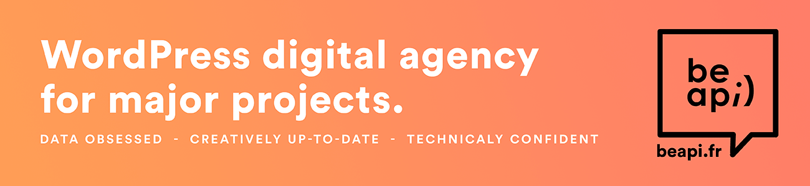

<a href="https://beapi.fr"></a>

# Composer Scaffold Theme

External composer command to scaffold a WordPress theme from a Be API boilerplate:

- [Be API Frontend Framework (BFF)](https://github.com/BeAPI/beapi-frontend-framework)
- [BeAPI Blocks Theme (BBT)](https://github.com/BeAPI/beapi-blocks-theme)

Increase your workflow when creating a new theme. By launching this composer command, you will easily and quickly choose the boilerplate, theme name, namespace and bootstrap your new theme.

# What ?

A simple command to generate a theme skeleton with all the cool features made by the Be API teams.

Two boilerplates are available:

| Key | Boilerplate | Use case |
|-----|-------------|----------|
| `bff` | Be API Frontend Framework | Classic PHP theme starter |
| `bbt` | Be API Blocks Theme | Block theme starter |

If you do not pass the `--boilerplate` option, the command will ask you interactively which boilerplate to use.

# How ?

## 1 - Add to [Composer](http://composer.rarst.net/)

- `composer require beapi/composer-scaffold-theme`

## 2 - Run command

```bash
composer scaffold-theme [--boilerplate|-b bff|bbt] [--boilerplate-version [BOILERPLATE-VERSION]] [--no-autoload] <folder>
```

**Options:**

- `--boilerplate`, `-b` — Boilerplate to use: `bff` or `bbt` (interactive choice if omitted)
- `--boilerplate-version` — Git ref to download (branch, tag or commit). Defaults to `Latest`
- `--no-autoload` — Skip adding the theme namespace to `composer.json` autoload
- `<folder>` — Your theme's folder name (required)

**Examples:**

```bash
# Interactive boilerplate choice
composer scaffold-theme my-theme

# BFF boilerplate
composer scaffold-theme --boilerplate=bff my-theme

# BBT boilerplate, specific version
composer scaffold-theme -b bbt --boilerplate-version=1.0.0 my-blocks-theme
```

# Who ?

Created by [Be API](https://beapi.fr), the French WordPress leader agency since 2009. Based in Paris, we are more than 30 people and always [hiring](https://beapi.workable.com) some fun and talented guys. So we will be pleased to work with you.

This plugin is only maintained, which means we do not guarantee some free support. If you identify any errors or have an idea for improving this script, feel free to open an [issue](../../issues/new). Please provide as much info as needed in order to help us resolving / approve your request. And .. be patient :)

If you really like what we do or want to thank us for our quick work, feel free to [donate](https://www.paypal.me/BeAPI) as much as you want / can, even 1€ is a great gift for buying cofee :)

## License

Composer Scaffold Theme is licensed under the [GPLv3 or later](LICENSE.md).
